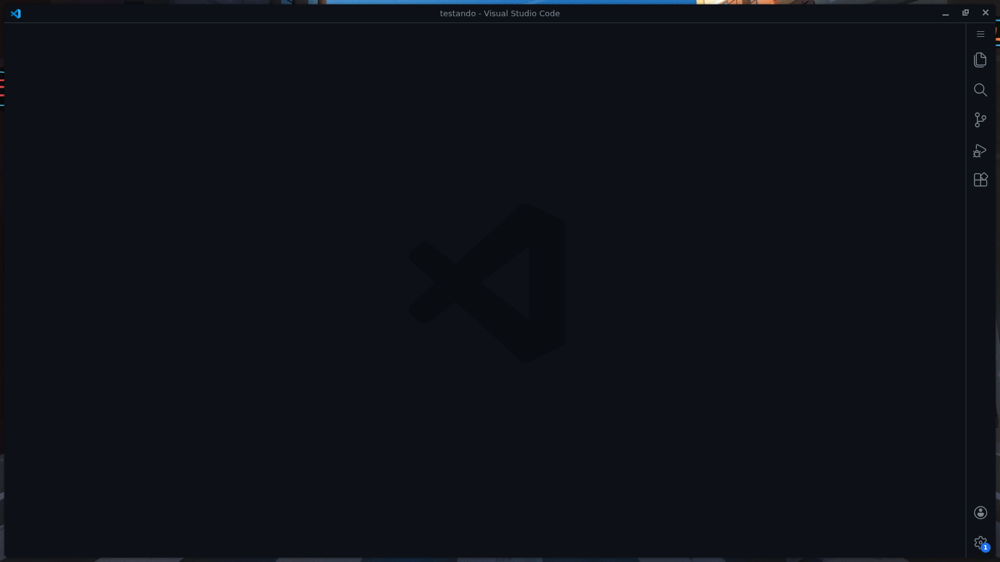
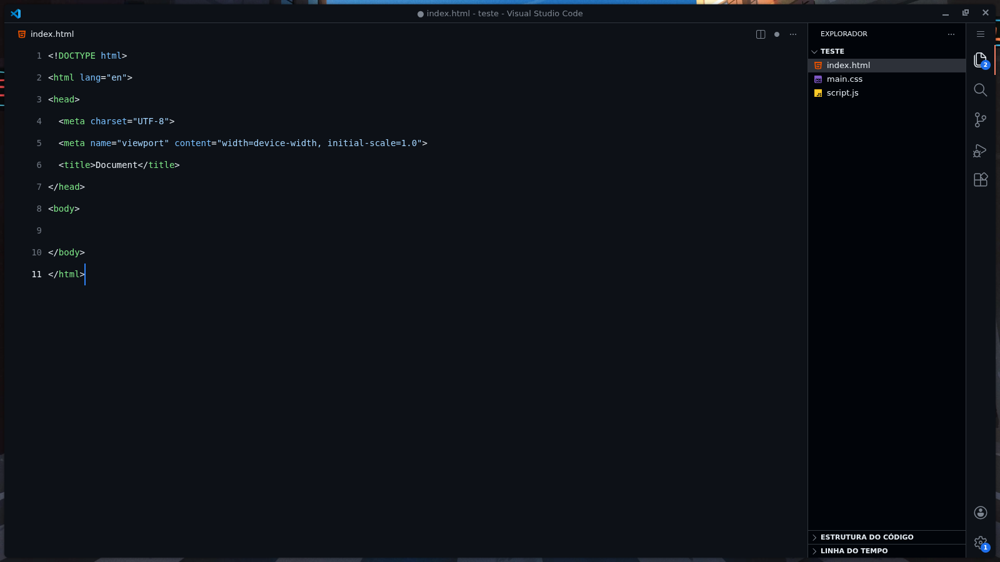

# 🎨 VS Code Minimalista

Uma configuração personalizada do **Visual Studio Code**, desenvolvida para oferecer um ambiente de programação mais limpo, organizado e agradável.

O objetivo é manter apenas o necessário, priorizando a produtividade, a boa leitura do código e uma interface visualmente agradável.

---

## 🖼️ Prévia

  

  

---

## ✨ Características

- Interface limpa e minimalista.
- Cores suaves e agradáveis aos olhos.
- Organização visual dos arquivos.
- Melhor experiência durante a programação.
- Visual simples, moderno e sem distrações.

---

## 📦 Extensões utilizadas

Para obter o mesmo visual, instale as seguintes extensões:

**Tema — GitHub Theme**

[Instalar extensão](https://marketplace.visualstudio.com/items?itemName=GitHub.github-vscode-theme)

**Ícones — Material Icon Theme**

[Instalar extensão](https://marketplace.visualstudio.com/items?itemName=PKief.material-icon-theme)

---

## ⚙️ Como instalar

Siga os passos abaixo para aplicar a configuração no seu VS Code.

**1. Copie as configurações**

Abra o arquivo `settings.json` deste repositório e copie todo o conteúdo.

**2. Abra o Visual Studio Code**

Utilize o atalho `Ctrl + Shift + P` para abrir a paleta de comandos.

**3. Acesse as configurações**

Pesquise por:

`Preferences: Open User Settings (JSON)`

**4. Aplique as alterações**

Cole o conteúdo copiado no arquivo de configurações e salve.

Pronto! Seu Visual Studio Code estará configurado com o visual deste projeto.

---

  Desenvolvido com dedicação.

